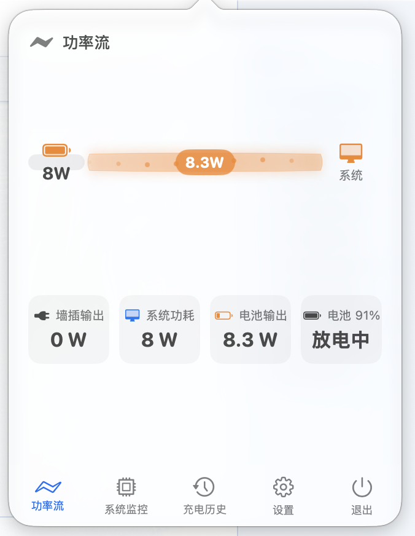
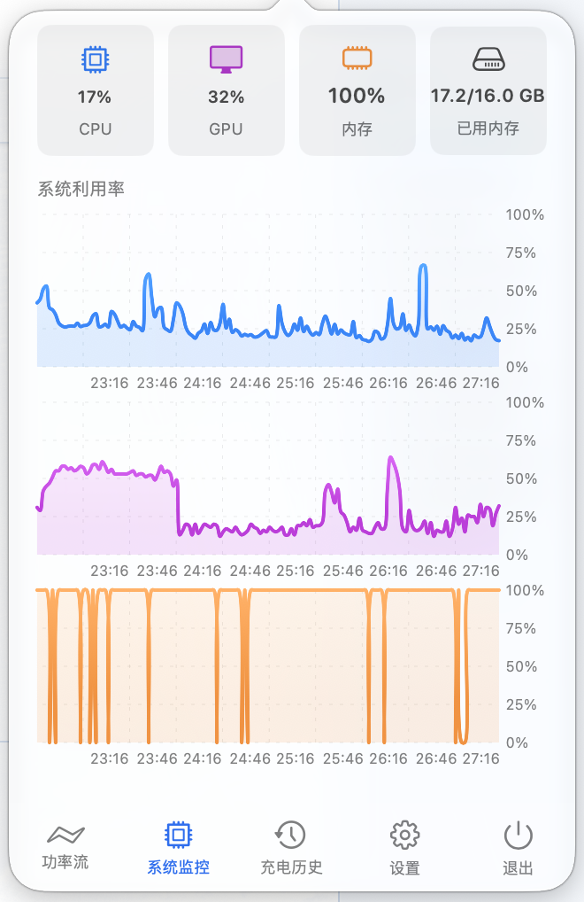
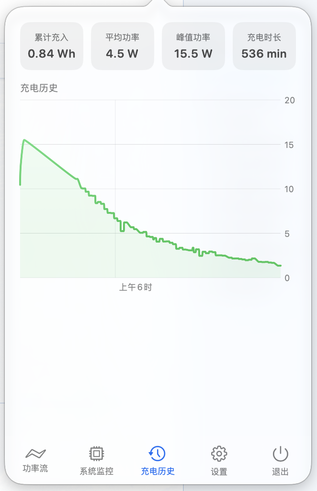

<p align="center">
  <strong>⚡ PowerPulse</strong><br>
  <em>macOS menu bar power & system monitor</em><br>
  <em>macOS 菜单栏电源 & 系统监控工具</em>
</p>

<p align="center">
  
  
  
</p>

<p align="center">
  🌐 <a href="https://777cola.github.io/PowerPulse/"><strong>Live Website / 在线展示网站 →</strong></a>
</p>

---

<p align="center">
  
  &nbsp;&nbsp;
  
  &nbsp;&nbsp;
  
</p>

## What's new in 2.0 / 2.0 重写了什么

2.0 是一次完整重写：从 SwiftUI 换成纯 AppKit，从 2903 行（其中 920 行是从没被引用的死代码）降到约 2600 行有效代码。

SwiftUI → pure AppKit. 2903 lines (920 of them dead) → ~2600 lines of live code.

| | 1.0 | 2.0 |
|---|---|---|
| UI | SwiftUI + Swift Charts | 纯 AppKit，自绘 / pure AppKit, hand-drawn |
| 构建 / build | `swift build`（要 Xcode） | `./build_app.sh`（CLT 即可） |
| 内存口径 / memory | `external_page_count` 重复计入，虚高 | 与活动监视器一致 |
| 历史 / history | 插电就清空、跨天丢弃 | SQLite 持久化，按天聚合 |
| 刷新 / refresh | 采样 1s、菜单栏 10s | 全链路 1s，插拔即时响应 |
| 死代码 / dead code | 920 行 | 0 |

修掉的 bug / Fixed:

- 内存占用被系统性虚报（`external_page_count` 本来就在 `active` 里，旧版又加了一次）
- 插电瞬间清空全部充电历史 / history wiped on every plug-in
- 只存当天数据，跨天丢失 / cross-day data dropped on load
- 菜单栏 10 秒才刷新一次，数字"跳一下就冻住"
- M 系列读不到电池温度（不在主节点，在 `AppleSmartBatteryPack`）/ battery temperature was never read on Apple silicon

## Features / 功能特性

### Charger identification / 充电器识别

- 当前协商功率 + 套装上限 + PD 档位表（5V/9V/12V/15V/20V）
- 厂商、型号、协议
- 体检结论：为什么没跑满——涓流、温控、线材/档位，还是满功率

---

- Negotiated wattage, the kit's ceiling, and the full PDO table
- Vendor / model / protocol
- A verdict on why charging isn't at full speed: taper, thermal, cable tier, or all good

### Menu Bar / 菜单栏

- 电量 + 电池图标 + 实时瓦数，等宽数字避免跳动
- 四种显示模式：百分比+功率 / 仅百分比 / 仅功率 / 仅图标
- 状态栏电池图标随状态变色：充电🟢（带闪电）、已接电源🟣、正常⚪、低电量🔴

---

- Percentage + battery icon + live wattage, tabular digits — no layout shift
- Four display modes
- Color-coded by power state

### Power Flow / 功率流

- 墙插 → 系统 / 电池两条流向，带宽与功率成正比
- 粒子流速随功率变化，插拔即时切换

---

- Wall → system / battery, band width proportional to wattage
- Particle speed follows the load

### System Monitor / 系统监控

- CPU / GPU / 内存，与活动监视器同口径
- 进程耗电排行（`rusage` 差分，不需要 root）
- 系统功耗曲线

---

- CPU / GPU / memory, matching Activity Monitor
- Per-process energy ranking via `rusage` deltas — no root needed

### History / 充电历史

- 本次充电：累计 Wh、平均/峰值功率、时长
- 功率曲线 + 近 7 天柱状图
- CSV 导出

---

- Current session: Wh, average/peak wattage, duration
- Power curve + 7-day chart + CSV export

### Battery Health / 电池健康

- 健康度、循环次数、设计容量 vs 实际容量、温度、年龄

### Extras / 其他

- 通知：低电量、充满、拔电、高温、充电异常
- 开机自启（`SMAppService`）
- **桌面小组件**（小 / 中两种尺寸）
- 三语：简体 / 繁體 / English

## Requirements / 系统要求

- macOS 14.0 (Sonoma) or later
- 主程序：CommandLineTools 即可编译 / main app builds with CommandLineTools alone
- 小组件：需要 Xcode 工具链（`xcrun swiftc`）/ widget needs the Xcode toolchain

## Install / 安装

Download `PowerPulse-Installer.dmg` from [Releases](https://github.com/777cola/PowerPulse/releases), open it and drag PowerPulse to Applications.

从 [Releases](https://github.com/777cola/PowerPulse/releases) 下载 `PowerPulse-Installer.dmg`，双击打开，将 PowerPulse 拖入 Applications 文件夹即可。

## Build from Source / 从源码构建

```bash
git clone https://github.com/777cola/PowerPulse.git
cd PowerPulse
./build_app.sh
cp -R PowerPulse.app /Applications/ && open /Applications/PowerPulse.app
```

### Widget / 小组件

小组件装在 `PowerPulse.app/Contents/PlugIns/PowerPulseWidget.appex`，数据通过
`~/Library/Containers/com.autumnpants.powerpulse.widget/Data/Library/Application Support/PowerPulse/widget.json` 传递（小组件被沙盒围住，只能读自己的容器）。

首次安装后如果小组件画廊里没有：

```bash
pluginkit -a /Applications/PowerPulse.app/Contents/PlugIns/PowerPulseWidget.appex
killall chronod
```

**注意**：`appex` 必须带 `com.apple.security.app-sandbox` entitlement，否则 `pluginkit` 根本不收录。ad-hoc 签名也可以，不需要开发者证书。

### Create DMG Installer / 创建安装包

```bash
./create_dmg.sh
```

## Project Structure / 项目结构

```
PowerPulse/
├── Sources/
│   ├── Support.swift        # 三语文案、设置项、设计常量
│   ├── Power.swift          # IOKit 采样、适配器解析、CPU/GPU/内存、耗能排行
│   ├── History.swift        # SQLite 持久化、聚合、CSV
│   ├── Services.swift       # 通知、登录项、更新检查、电源事件
│   ├── FlowView.swift       # 功率流动画（自绘）
│   ├── Panels.swift         # 五个面板
│   ├── Widgets.swift        # 卡片、Tab、开关等控件
│   ├── Charts.swift         # 折线 / 柱状 / 进度条
│   ├── WidgetBridge.swift   # 写给桌面小组件的快照
│   └── main.swift           # 状态栏 + 弹窗 + 入口
├── SourcesWidget/           # WidgetKit 扩展
├── assets/AppIcon.icns
├── build_app.sh             # 一条命令出 .app（含小组件）
├── create_dmg.sh
└── docs/                    # 展示网站
```

## Technical Details / 技术细节

| Component | API | 说明 |
|-----------|-----|------|
| 功率 / power | `AppleSmartBattery → PowerTelemetryData` | 墙插、系统、电池功率 |
| 电池 / battery | `AppleSmartBattery → BatteryData` | 百分比、循环、容量 |
| 温度 / temp | `AppleSmartBatteryPack → BatteryData.Temperature` | ÷100 ℃ |
| 充电器 / adapter | `AdapterDetails` | `Watts` / `AdapterVoltage` / `Current` / `UsbHvcMenu` |
| 限速原因 | `ChargerData` | `SlowChargingReason` / `NotChargingReason` / `TimeChargingThermallyLimited` |
| CPU | `host_processor_info()` | |
| GPU | `IOAccelerator → PerformanceStatistics` | |
| 内存 / memory | `host_statistics64()` | active − purgeable + wired + compressed |
| 进程耗电 | `proc_pid_rusage(RUSAGE_INFO_V6)` | `ri_energy_nj` 差分 |
| UI | AppKit + Core Graphics | |
| 小组件 | WidgetKit + SwiftUI | |

## Known limitations / 已知限制

- USB-C 线材的 e-marker 信息 macOS 不对外暴露，所以"是不是线拖后腿"只能靠推断（档位表显示 100W 但一直协商在 60W），不能像专业电流表那样测死
- ad-hoc 签名，对外分发仍会被 Gatekeeper 拦，需要右键打开
- 耗电排行只统计当前用户可见的进程

## License / 开源协议

[MIT](LICENSE) © [AutumnPants](https://github.com/777cola)
