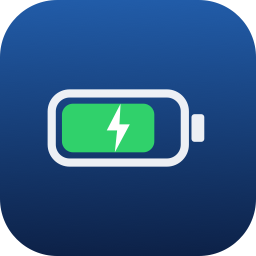
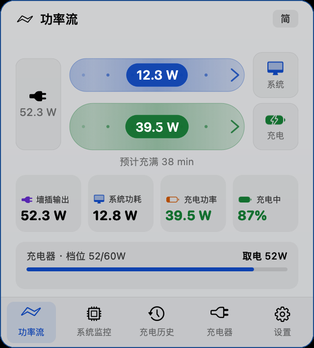
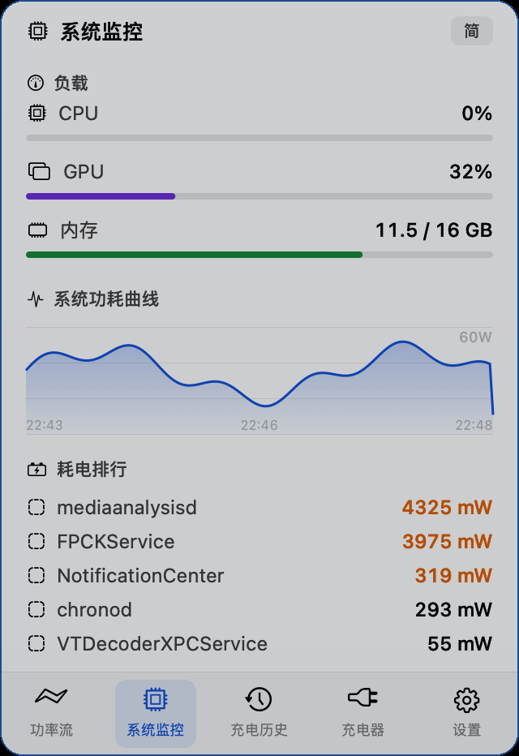
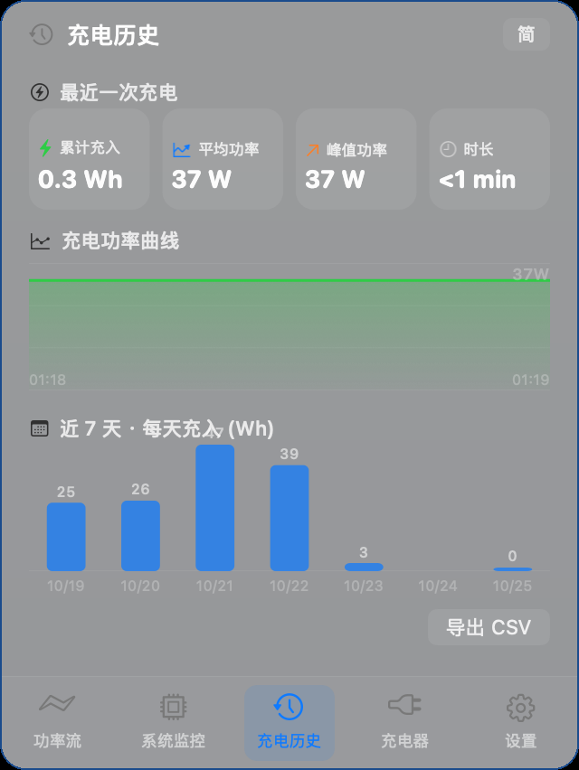
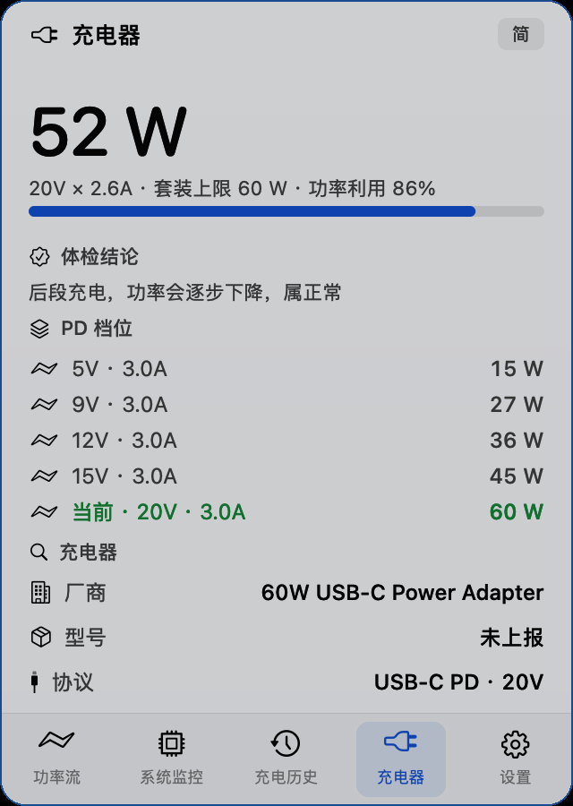

<div align="center">



<picture>
  <source media="(prefers-color-scheme: dark)" srcset="docs/img/wordmark-dark.png">
  
</picture>

<br>

<b>菜单栏里，看清每一瓦。</b>

<sub>macOS 14+ · Apple Silicon · 纯 AppKit · 无第三方依赖</sub>

<br><br>

<p>
  <a href="https://powerpulse.qijunhao.xyz"><b>官网</b></a>
  &nbsp;·&nbsp;
  <a href="https://github.com/777cola/PowerPulse/releases"><b>下载</b></a>
  &nbsp;·&nbsp;
  <a href="https://github.com/777cola/PowerPulse/issues"><b>反馈</b></a>
</p>

<p>
  
  
  
</p>

<br>

<picture>
  <source media="(prefers-color-scheme: dark)" srcset="docs/img/readme-flow-dark.png">
  
</picture>

</div>

## 安装

```bash
curl -fsSL https://powerpulse.qijunhao.xyz/install.sh | bash
```

查最新版、下载、解压到 `/Applications`、启动。升级重跑同一条。

终端下载的文件不带 `com.apple.quarantine`，所以 Gatekeeper 一次都不会拦。用浏览器下载的包见下方[打不开怎么办](#打不开怎么办)。

## 三个数必须对得上

电源数据本来就在系统里，只是没人摆到一起。PowerPulse 每秒读一次寄存器，把三件事拆开：

| | 读数 | 含义 |
|---|---|---|
| **墙插** | `SystemPowerIn` | 充电器实际输进机器的功率 |
| **系统** | `SystemLoad` | CPU / 屏幕 / 内存吃掉的 |
| **电池** | `BatteryPower` | 充电时进电池，放电时出电池 |

**墙插 ≈ 系统 + 电池。** 对不上，就是有地方在偷偷耗电。

## 五个面板

| 面板 | 回答什么 |
|---|---|
| **功率流** | 能量从哪来、到哪去。带子粗细跟着瓦数走：正常充电时充电器分成「系统 + 电池」两路；充电器带不动整机时，充电器和电池两路一起喂系统 |
| **系统监控** | CPU / GPU / 内存占用，5 分钟功耗曲线，按能耗排序的进程榜 |
| **充电历史** | 最近一次充进去多少 Wh、近 7 天每天多少、导出 CSV |
| **充电器** | 协商到几伏几安、支持哪些 PD 档位、为什么没跑满 |
| **设置** | 采样间隔、历史保留、通知阈值、菜单栏显示、语言 |

<table>
<tr>
<td align="center"><picture><source media="(prefers-color-scheme: dark)" srcset="docs/img/readme-monitor-dark.png"></picture><br><sub>系统监控</sub></td>
<td align="center"><picture><source media="(prefers-color-scheme: dark)" srcset="docs/img/readme-history-dark.png"></picture><br><sub>充电历史</sub></td>
<td align="center"><picture><source media="(prefers-color-scheme: dark)" srcset="docs/img/readme-adapter-dark.png"></picture><br><sub>充电器</sub></td>
</tr>
</table>

## 充电器体检

插上电只看到「正在充电」没有意义，PowerPulse 把充电器的底细读出来：

- **协商档位** — 当前电压电流，例如 `20V × 2.6A`
- **能力上限** — `UsbHvcMenu` 里的完整 PDO 表（5V / 9V / 12V / 15V / 20V）
- **为什么没跑满** — 涓流、温控、慢充原因，直接给结论而不是原始码

线材的 e-marker 读不到，macOS 不暴露。只能通过「档位表上限 vs 实际协商值」推断是不是线材拖后腿。

## 它自己有多费电

一个测电源的软件，自己先不能费电。

| 状态 | CPU | 内存 |
|---|---|---|
| 弹窗关闭（常驻） | **0.4%** | 20 MB |
| 系统监控 / 历史 / 充电器 / 设置 | 0.4–0.8% | 62–74 MB |
| 功率流（带动画） | 2–3.5% | 126 MB |

功率流那一栏内存偏高：视图每秒重绘 30 次，系统会给这扇窗口准备一套合成缓冲，关掉弹窗也不会立刻退回。看数据时开着没关系，长期挂着看菜单栏的话，切到别的面板或者直接关掉弹窗。

省电的做法：状态栏标题只在内容变化时重建、电池图标按「电量 / 颜色 / 闪电」缓存、隐藏面板停止动画、功率流把静态部分缓存成一张位图，每帧只画点阵和扫光。

## 数据都在本机

不联网，不上传，没有账号，没有遥测。

- 数据库 `~/Library/Application Support/PowerPulse/history.db`（SQLite + WAL）
- 偏好 `~/Library/Preferences/com.autumnpants.powerpulse.plist`
- 小组件快照 App Group 容器，未签名运行时回退到 Application Support

卸载：退出 App，删掉 `/Applications/PowerPulse.app`，再删上面两个路径。

## 其他

- **菜单栏** — 百分比 + 功率、仅百分比、仅功率、仅图标，四种显示
- **桌面小组件** — WidgetKit，不打开面板也能看当前功率
- **通知** — 低电量、充满、拔电、高温、慢充异常，可逐项开关
- **历史** — SQLite + WAL，默认保留 30 天，随用随导
- **语言** — 简体中文 / 繁體中文 / English
- **开机自启** — `SMAppService`

## 打不开怎么办

App 用 ad-hoc 签名，没有 Apple 公证，浏览器下载的包首次打开会被拦一次。

1. **系统设置** — 双击报错后 →「隐私与安全性」→ 拉到底 →「仍要打开」。macOS 15 起右键「打开」已绕不过去，只能用这里。
2. **右键打开** — macOS 14 及更早可用：右键 App → 打开 → 再点一次「打开」。
3. **终端** — `xattr -dr com.apple.quarantine /Applications/PowerPulse.app`，只做一次。

为什么没公证：Developer ID 证书需要付费开发者账号（99 美元/年）。有账号后 `IDENTITY="Developer ID Application: ..." NOTARY_PROFILE=powerpulse ./build_app.sh` 就能出正式签名并公证的版本。

## 已知限制

| 限制 | 说明 |
|---|---|
| **Intel Mac** | 二进制只有 arm64。Intel 机器改 `build_app.sh` 里的 `-target` 自行编译 |
| **iPhone 电池** | 需要 `libimobiledevice`，本版没做 |
| **线材 e-marker** | macOS 不暴露，只能推断 |
| **台式机** | Mac Studio / mini / Pro 没有 `AppleSmartBattery`。整机功率向 SMC 要（`PSTR` / `PDTR`，不需要 root）：读得到显示瓦数，读不到退回落 CPU 占用 |

<details>
<summary><b>从源码构建</b></summary>

<br>

需要 macOS 14+ 和命令行工具（`xcode-select --install`）：

```bash
git clone https://github.com/777cola/PowerPulse.git
cd PowerPulse
./build_app.sh      # 产出 PowerPulse.app，小组件已打进 PlugIns/
open PowerPulse.app
```

不需要 Xcode 工程，也不需要 CocoaPods / SPM。本机编译出来的 App 没有隔离标记，双击直接开。

</details>

<details>
<summary><b>数据从哪来</b></summary>

<br>

| 数据 | 来源 |
|---|---|
| 电池功率、电压电流、循环次数、温度 | IOKit `AppleSmartBattery`（温度在 `AppleSmartBatteryPack.BatteryData`） |
| 充电器协商功率、PD 档位、厂商型号 | `AdapterDetails`、`UsbHvcMenu` |
| 整机功率（台式机） | AppleSMC `PSTR` / `PDTR` |
| 进程能耗 | `rusage_info_v6` 的 `ri_energy_nj` 差分，不需要 root |
| 系统负载 | `host_statistics` / `IOAccelerator` |

没有估算、没有模型拟合，全部是寄存器原值。

</details>

<details>
<summary><b>开发与自检</b></summary>

<br>

```
Sources/
  main.swift         状态栏、弹窗控制器、程序入口
  Support.swift      三语文案、设置、设计常量
  Power.swift        IOKit 采样、电池 / 充电器模型
  SMCPower.swift     台式机整机功率（AppleSMC）
  History.swift      SQLite 存储、会话统计、CSV 导出
  Services.swift     通知、开机自启、更新检查、插拔监听
  Widgets.swift      指标卡、TabBar、布局工具
  FlowView.swift     功率流图示（静态层缓存 + 30fps 动画层）
  Charts.swift       折线图、柱状图
  Panels.swift       五个面板
  WidgetBridge.swift 小组件快照推送
SourcesWidget/
  WidgetSnapshot.swift   主程序与小组件共享的快照
  PowerPulseWidget.swift WidgetKit 时间线与视图
```

主程序带一套离屏渲染和无界面测试，改 UI 时不用靠肉眼：

```bash
./build/PowerPulse --selftest /tmp/pp            # 5 面板 × 3 语言，导出 PNG
./build/PowerPulse --selftest /tmp/pp --dark     # 深色
./build/PowerPulse --selftest /tmp/pp --plugged  # 假数据渲染插电双带布局
./build/PowerPulse --export                      # 验证 CSV 导出
./build/PowerPulse --statusbar /tmp/sb --alpha   # 菜单栏标题离屏渲染
./build/PowerPulse --cycle=24                    # 反复开关弹窗，压测视图泄漏
./build/PowerPulse --smc-probe                   # 列出 SMC 电源相关键
```

自检里还有一层布局审计：任何控件超出父视图 3pt 以上都会打印出来。

</details>

## 变更

| 版本 | 内容 |
|---|---|
| **2.1.2** | 状态卡改成「状态 + 电量大字」，英文 `Battery 100%` 不再被卡片切掉；两路供电的汇流线改成弧线接进系统；体检结论在充电器带不动时直接给缺口；高温提醒不再只在充电时触发 |
| **2.1.1** | 修功率流「插着电就一定在充电」的假设：`IsCharging` 只说明充电器在线，电池可能在放电。现在分三种流向，并修「预计充满 1092:15」（系统给的是 65535 哨兵值） |
| **2.1.0** | 台式机支持；修电池机菜单栏「插头与电池图标并排」；修 100% 仍显示「预计充满 44 分钟」；系统监控补 5 分钟时间刻度 |
| **2.0.0** | 纯 AppKit 重写。修旧版历史插电即清空、内存重复计数、菜单栏 10 秒才刷新；新增充电器识别、充电体检、SQLite 历史、通知、桌面小组件、三语界面 |
| **1.0.x** | SwiftUI 初版，基础电量与功率显示 |

## License

MIT © AutumnPants

<div align="center"><sub>用得上就给个 ⭐。</sub></div>

---

<div align="center">

<h2>PowerPulse <sub>English</sub></h2>

<b>Every watt, right in your menu bar.</b>

<sub>macOS 14+ · Apple Silicon · pure AppKit · no dependencies</sub>

<br><br>

<p>
  <a href="https://powerpulse.qijunhao.xyz/en/"><b>Website</b></a>
  &nbsp;·&nbsp;
  <a href="https://github.com/777cola/PowerPulse/releases"><b>Download</b></a>
  &nbsp;·&nbsp;
  <a href="https://github.com/777cola/PowerPulse/issues"><b>Feedback</b></a>
</p>

</div>

### Install

```bash
curl -fsSL https://powerpulse.qijunhao.xyz/install.sh | bash
```

Fetches the latest release, unpacks it into `/Applications`, launches it. Re-run to upgrade. Files fetched with curl carry no `com.apple.quarantine`, so Gatekeeper never steps in.

### What it shows

Three numbers that must add up:

| | Reading | Meaning |
|---|---|---|
| **Wall** | `SystemPowerIn` | what the charger actually delivers |
| **System** | `SystemLoad` | what the machine consumes |
| **Battery** | `BatteryPower` | in while charging, out while discharging |

**Wall ≈ System + Battery.** When it doesn't, something is leaking.

### Panels

| Panel | Answers |
|---|---|
| **Power Flow** | Where energy goes; band thickness follows wattage. Charging splits into system + battery; if the charger can't keep up, charger and battery feed the system together |
| **System** | CPU / GPU / memory, a 5-minute power curve, energy-ranked process list |
| **History** | Last session's Wh, 7-day bars, CSV export |
| **Adapter** | Negotiated volts/amps, PD capability table, and why it isn't maxed out |
| **Settings** | Sampling interval, retention, alerts, menu bar style, language |

Beyond "charging", the Adapter panel reads the charger's own registers: negotiated `20V × 2.6A`, the full PDO table from `UsbHvcMenu`, and a verdict when power is below expectation — trickle, thermal, slow-charge reason. Cable e-marker isn't exposed by macOS, so cable quality can only be inferred.

### Cost of monitoring

| State | CPU | Memory |
|---|---|---|
| Popover closed | **0.4%** | 20 MB |
| Any static panel | 0.4–0.8% | 62–74 MB |
| Power Flow (animated) | 2–3.5% | 126 MB |

The animated panel is the expensive one: redrawing 30 times a second makes the system keep a compositing buffer set for that window, and it doesn't shrink the moment you close the popover.

### Privacy

Everything stays on this machine — no network, no account, no telemetry.

- `~/Library/Application Support/PowerPulse/history.db`
- `~/Library/Preferences/com.autumnpants.powerpulse.plist`

Uninstall: quit, delete the app, delete those two paths.

### Gatekeeper

Ad-hoc signed, **not notarized** — a browser download is blocked once. Use the install script above, or afterwards: System Settings → Privacy & Security → "Open Anyway", or `xattr -dr com.apple.quarantine /Applications/PowerPulse.app`.

Notarization needs a paid Apple Developer account (USD 99/yr). With one: `IDENTITY="Developer ID Application: ..." NOTARY_PROFILE=powerpulse ./build_app.sh`.

### Known limits

| Limit | Note |
|---|---|
| **Intel Mac** | arm64 only; rebuild with a `-target` of your own |
| **iPhone battery** | needs `libimobiledevice`, not in this version |
| **Cable e-marker** | invisible to macOS |
| **Desktops** | no `AppleSmartBattery`; system power comes from SMC (`PSTR` / `PDTR`, no root), CPU load otherwise |

<details>
<summary><b>Build from source</b></summary>

<br>

```bash
git clone https://github.com/777cola/PowerPulse.git
cd PowerPulse && ./build_app.sh && open PowerPulse.app
```

No Xcode project, no package manager. Headless self-checks:

```bash
./build/PowerPulse --selftest /tmp/pp --dark --plugged
./build/PowerPulse --export
./build/PowerPulse --cycle=24
```

</details>

### License

MIT © AutumnPants
