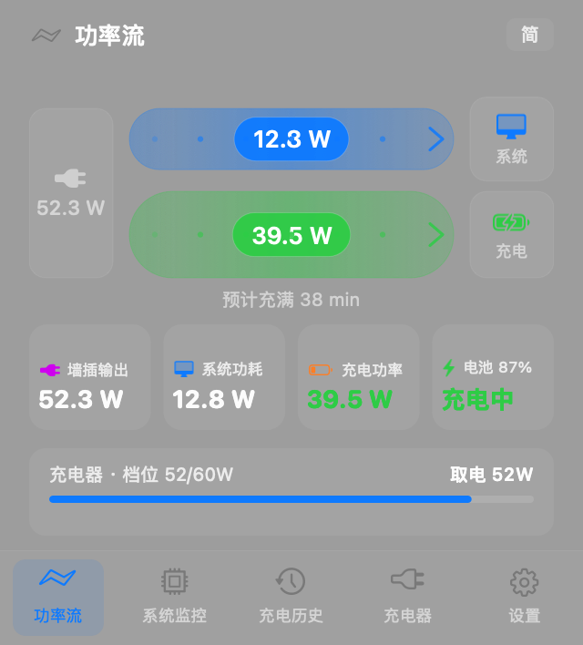
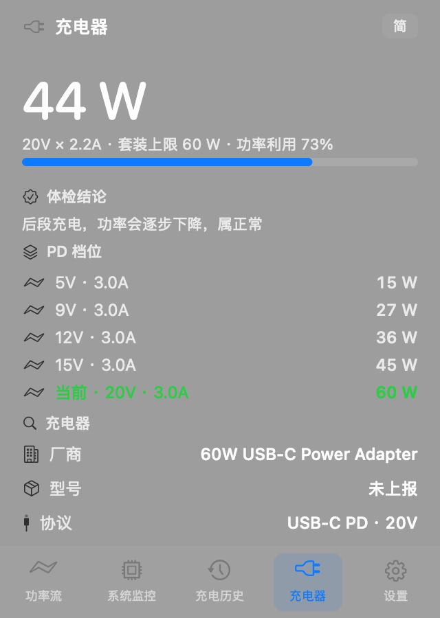
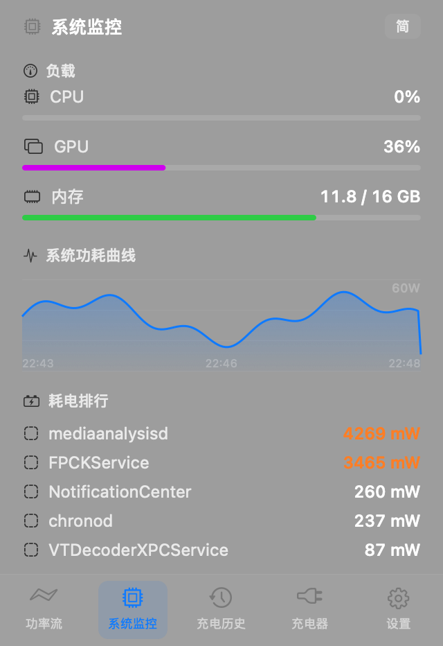

<div align="center">

<h1>PowerPulse</h1>

<p><b>菜单栏里，看清每一瓦。</b></p>

<p>macOS 菜单栏电源监控 · 每秒采样 · 识别充电器 PD 档位 · 记录 30 天历史</p>

<p>
  <a href="https://github.com/777cola/PowerPulse/releases"></a>
  
  
  
</p>

<p>
  <a href="https://powerpulse.qijunhao.xyz">官网</a> ·
  <a href="https://github.com/777cola/PowerPulse/releases">下载</a> ·
  <a href="https://powerpulse.qijunhao.xyz/assets/powerbench.html">解剖图</a> ·
  <a href="https://github.com/777cola/PowerPulse/issues">反馈</a>
</p>



</div>

---

## 安装

```bash
curl -fsSL https://powerpulse.qijunhao.xyz/install.sh | bash
```

查最新版、下载、解压到 `/Applications`、启动。升级时重跑同一条。

终端下载的文件不带 `com.apple.quarantine` 标记，所以 Gatekeeper 不会拦——这条路一次弹窗都没有。用浏览器下载的话，见下文「手动安装与 Gatekeeper」。

## 它做什么

电源数据本来就在系统里，只是没人摆到一起。PowerPulse 每秒读一次寄存器，把三件事拆开：

- **墙插给了多少** — `SystemPowerIn`，充电器实际输进机器的功率
- **系统吃了多少** — `SystemLoad`，CPU / 屏幕 / 内存加起来
- **电池进了多少** — 充电时进电池，放电时出电池

三者必须能互相加减：`墙插 ≈ 系统 + 电池`。对不上，就是有地方在偷偷耗电。

## 五个面板

| 面板 | 回答的问题 |
|---|---|
| **功率流** | 能量从哪来、到哪去。带子粗细跟着瓦数走，充电时自动分成系统与电池两条 |
| **系统监控** | CPU / GPU / 内存占用，5 分钟功耗曲线，按能耗排序的进程榜 |
| **充电历史** | 最近一次充进去多少 Wh、近 7 天每天多少、导出 CSV |
| **充电器** | 协商到几伏几安、支持哪些 PD 档位、为什么没跑满 |
| **设置** | 采样间隔、历史保留、通知阈值、菜单栏显示、语言 |

 

## 充电器体检

插上电只看到「正在充电」没有意义，PowerPulse 把充电器的底细读出来：

- **协商档位** — 当前电压电流，例如 `20V × 2.6A`
- **能力上限** — `UsbHvcMenu` 里的完整 PDO 表（5V / 9V / 12V / 15V / 20V）
- **为什么没跑满** — 涓流、温控、慢充原因，直接给结论而不是原始码

线材的 e-marker 读不到，macOS 不暴露。只能通过「档位表上限 vs 实际协商值」推断是不是线材拖后腿。

## 其他

- **菜单栏**：百分比 + 功率、仅百分比、仅功率、仅图标，四种显示
- **桌面小组件**：WidgetKit，不打开面板也能看当前功率
- **通知**：低电量、充满、拔电、高温、慢充异常，可逐项开关
- **历史**：SQLite + WAL，默认保留 30 天，随用随导
- **语言**：简体中文 / 繁體中文 / English
- **开机自启**：`SMAppService`

## 它自己有多费电

一个测电源的软件，自己先不能费电。

| 状态 | CPU | 内存 |
|---|---|---|
| 弹窗关闭（常驻） | **0.4%** | 20 MB |
| 系统监控 / 历史 / 充电器 / 设置 | 0.4–0.8% | 62–74 MB |
| 功率流（带动画） | 2–3.5% | 126 MB |

功率流那一栏内存偏高：视图每秒重绘 30 次，系统会给这扇窗口准备一套合成缓冲，关掉弹窗也不会立刻退回。看功耗数据时开着它没关系，长期挂着看菜单栏的话，切到别的面板或者直接关掉弹窗。

省电的做法：状态栏标题只在内容变化时重建、电池图标按「电量 / 颜色 / 闪电」缓存、隐藏面板停止动画、功率流把静态部分缓存成一张位图，每帧只画点阵和扫光。

## 数据在哪

全部在本机，不联网，不上传，没有账号。

- 数据库：`~/Library/Application Support/PowerPulse/history.db`（SQLite + WAL）
- 偏好：`~/Library/Preferences/com.autumnpants.powerpulse.plist`
- 小组件快照：App Group 容器，未签名运行时回退到 Application Support

卸载：退出 App，删掉 `/Applications/PowerPulse.app`，再删上面两个路径即可。

## 手动安装与 Gatekeeper

**一行命令**（推荐）——见开头，不会有任何弹窗。

**手动下载**：到 [Releases](https://github.com/777cola/PowerPulse/releases) 下载 zip，拖进「应用程序」。

App 用 ad-hoc 签名，没有 Apple 公证，所以浏览器下载的包首次打开会被拦一次。三种放行方式：

1. **系统设置**：双击报错后 → 系统设置 → 隐私与安全性 → 拉到底 → 「仍要打开」。macOS 15 起右键「打开」已不能绕过，只能用这里。
2. **右键打开**：macOS 14 及更早可用，右键 App → 打开 → 再点一次「打开」。
3. **终端**：`xattr -dr com.apple.quarantine /Applications/PowerPulse.app`，只做一次。

为什么没公证：Developer ID 证书需要付费开发者账号（99 美元/年）。有这个账号后，`IDENTITY="Developer ID Application: ..." NOTARY_PROFILE=powerpulse ./build_app.sh` 就能出正式签名并公证的版本。

## 从源码构建

需要 macOS 14+ 和命令行工具（`xcode-select --install`）：

```bash
git clone https://github.com/777cola/PowerPulse.git
cd PowerPulse
./build_app.sh          # 产出 PowerPulse.app，小组件已打进 PlugIns/
open PowerPulse.app
```

不需要 Xcode 工程，也不需要 CocoaPods / SPM。本机编译出来的 App 没有隔离标记，双击直接开。

## 数据从哪来

| 数据 | 来源 |
|---|---|
| 电池功率、电压电流、循环次数、温度 | IOKit `AppleSmartBattery`（温度在 `AppleSmartBatteryPack.BatteryData`）|
| 充电器协商功率、PD 档位、厂商型号 | `AdapterDetails`、`UsbHvcMenu` |
| 进程能耗 | `rusage_info_v6` 的 `ri_energy_nj` 差分，不需要 root |
| 系统负载 | `host_statistics` / `IOAccelerator` |

没有估算、没有模型拟合，全部是寄存器原值。

## 开发

```
Sources/
  main.swift         状态栏、弹窗控制器、程序入口
  Support.swift      三语文案、设置、设计常量
  Power.swift        IOKit 采样、电池 / 充电器模型
  History.swift      SQLite 存储、会话统计、CSV 导出
  Services.swift     通知、开机自启、更新检查、插拔监听
  Widgets.swift      指标卡、TabBar、布局工具
  FlowView.swift     功率流图示（静态层缓存 + 30fps 动画层）
  Charts.swift       折线图、柱状图
  Panels.swift       五个面板
  WidgetBridge.swift 小组件快照推送
SourcesWidget/
  WidgetSnapshot.swift   主程序与小组件共享的快照
  PowerPulseWidget.swift WidgetKit 时间线与视图
```

### 自检

主程序带一套离屏渲染和无界面测试，改 UI 时不用靠肉眼：

```bash
./build/PowerPulse --selftest /tmp/pp            # 5 面板 × 3 语言，导出 PNG
./build/PowerPulse --selftest /tmp/pp --dark     # 深色
./build/PowerPulse --selftest /tmp/pp --plugged  # 用假数据渲染插电双带布局
./build/PowerPulse --export                      # 验证 CSV 导出
./build/PowerPulse --statusbar /tmp/sb --alpha   # 菜单栏标题离屏渲染
./build/PowerPulse --cycle=24                    # 反复开关弹窗，压测视图泄漏
```

自检里还有一层布局审计：任何控件超出父视图 3pt 以上都会打印出来。

## 已知限制

- **iPhone 电池**：需要 `libimobiledevice`，当前版本没做
- **线材 e-marker**：macOS 不暴露，只能推断
- **台式机（Mac Studio / mini / Pro）**：没有 `AppleSmartBattery`，墙插和电池功率都读不到。功率流面板会直接说明，系统监控的曲线自动改成 CPU 占用
- **Intel Mac**：当前二进制是 arm64，Intel 机器跑不了（改 `build_app.sh` 里的 `-target` 自行编译）
- **未公证**：见上文，需要付费开发者账号

## 变更

**2.0.0 之后**（未发版）— 系统监控补 5 分钟时间刻度；采样缓冲改成按时间算容量，跟文档对齐。

**2.0.0** — 纯 AppKit 重写。修复旧版历史插电即清空、内存重复计数、菜单栏 10 秒才刷新；新增充电器识别、充电体检、SQLite 历史、通知、桌面小组件、三语界面。

**1.0.x** — SwiftUI 版本，基础电量与功率显示。

## License

MIT © AutumnPants

---

<div align="center"><sub>如果用得上，给个 ⭐ 就行。</sub></div>

---

# PowerPulse (English)

**Every watt, right in your menu bar.**

A macOS menu bar power monitor: samples once per second, decodes USB-C PD negotiation, keeps 30 days of history. Pure AppKit, no dependencies.

## Install

```bash
curl -fsSL https://powerpulse.qijunhao.xyz/install.sh | bash
```

Fetches the latest release, unpacks it into `/Applications`, launches it. Re-run to upgrade.

Files fetched with curl carry no `com.apple.quarantine` flag, so Gatekeeper stays out of the way — no dialogs at all.

## What it shows

Three numbers that must add up:

- **Wall input** — `SystemPowerIn`, what the charger actually delivers
- **System load** — `SystemLoad`, what the machine consumes
- **Battery flow** — in while charging, out while discharging

`Wall ≈ System + Battery`. When it doesn't, something is leaking.

## Panels

| Panel | Answers |
|---|---|
| **Power Flow** | Where energy goes; band thickness follows wattage |
| **System** | CPU / GPU / memory, a 5-minute power curve, energy-ranked process list |
| **History** | Last session's Wh, 7-day bars, CSV export |
| **Adapter** | Negotiated volts/amps, PD capability table, and why it isn't maxed out |
| **Settings** | Sampling interval, retention, alerts, menu bar style, language |

## Adapter checkup

Beyond "charging", PowerPulse reads the charger's own register: negotiated voltage and current (`20V × 2.6A`), the full PDO table from `UsbHvcMenu`, and a verdict when power is below expectation — trickle, thermal, slow-charge reason.

Cable e-marker is not exposed by macOS, so cable quality can only be inferred from "capability vs negotiated".

## Cost of monitoring

| State | CPU | Memory |
|---|---|---|
| Popover closed | **0.4%** | 20 MB |
| Any static panel | 0.4–0.8% | 62–74 MB |
| Power Flow (animated) | 2–3.5% | 126 MB |

The animated panel is the expensive one: redrawing 30 times a second makes the system keep a compositing buffer set for that window, and it doesn't shrink the moment you close the popover.

## Where your data lives

Everything stays on this machine — no network, no account, no telemetry.

- `~/Library/Application Support/PowerPulse/history.db` (SQLite + WAL)
- `~/Library/Preferences/com.autumnpants.powerpulse.plist`

Uninstall: quit, delete the app, delete those two paths.

## Gatekeeper

The build is ad-hoc signed and **not notarized**, so a browser-downloaded copy is blocked once. Either use the install script above, or:

1. **System Settings** — after the error, go to Privacy & Security, scroll down, click "Open Anyway". (On macOS 15+ the old right-click → Open shortcut no longer bypasses Gatekeeper.)
2. **Terminal** — `xattr -dr com.apple.quarantine /Applications/PowerPulse.app`

Notarization needs a paid Apple Developer account (USD 99/yr). With one: `IDENTITY="Developer ID Application: ..." NOTARY_PROFILE=powerpulse ./build_app.sh`.

## Build from source

macOS 14+ and Command Line Tools:

```bash
git clone https://github.com/777cola/PowerPulse.git
cd PowerPulse && ./build_app.sh && open PowerPulse.app
```

No Xcode project, no package manager.

## Where the numbers come from

`AppleSmartBattery` (IOKit) for power, current, cycles and temperature; `AdapterDetails` and `UsbHvcMenu` for the charger; `rusage_info_v6`'s `ri_energy_nj` delta for per-process energy. No estimation, no model fitting.

## Development

`./build_app.sh` builds the app and the widget extension with `swiftc` alone. Headless self-checks:

```bash
./build/PowerPulse --selftest /tmp/pp --dark --plugged
./build/PowerPulse --export
./build/PowerPulse --cycle=24
```

The self-test renders every panel in every language offscreen and audits the layout for overflow.

## Known limits

- iPhone battery readout needs `libimobiledevice` — not in this version
- Cable e-marker is invisible to macOS
- Desktops (Mac Studio / mini / Pro) have no `AppleSmartBattery`, so wall and battery wattage are unavailable; the Power Flow panel says so and the curve switches to CPU load
- Intel Macs: the shipped binary is arm64 only; rebuild with `-target x86_64-apple-macos14.0`
- Not notarized — see above

## License

MIT © AutumnPants
